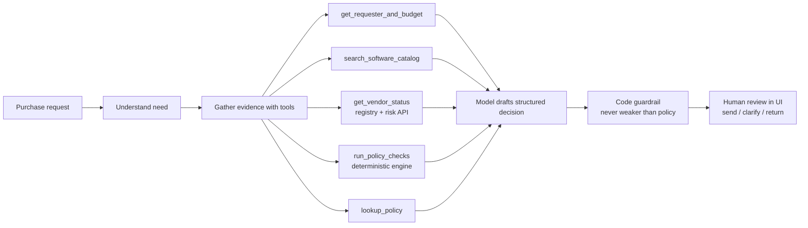
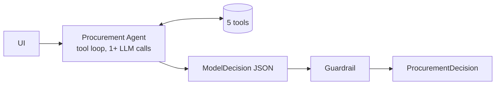
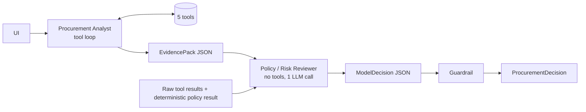

# Architecture and workflow

## Design principle

| Layer | Owns | Examples |
|---|---|---|
| **AI** | Interpretation and recommendation | Is the stated gap credible? Which next step, and who acts? |
| **Code** | Thresholds and deterministic checks | Approval tiers, budget arithmetic, 365-day review window, required fields, injection scan |
| **Human** | Approvals and exceptions | Every decision; the copilot only recommends and logs the reviewer's action |

## Workflow

## Architecture A: single agent

One Claude agent receives the request, calls the tools it needs and returns a `ModelDecision` via structured output. Typically 2 to 3 model calls.

## Architecture B: staged (two agents)

The analyst gathers and interprets, the reviewer checks the pack against policy and decides. Typically 3 to 4 model calls.

## Reference baseline: rules only

`architecture="rules"` skips the model entirely and converts the deterministic `PolicyResult` into a decision. It is not a candidate to ship; it shows how much the model adds on top of code.

## Tools

| Tool | Deterministic | What it does |
|---|---|---|
| `get_requester_and_budget` | yes | Employee, manager, department, available budget |
| `search_software_catalog` | yes | Same product / vendor / category matches and purchase history |
| `get_vendor_status` | yes | Registry row + external risk API, currency vs. reference date, conflict detection, availability |
| `run_policy_checks` | yes | All policy rules: required fields, budget, approval tiers, security/privacy/legal triggers, expiry, overlap, injection |
| `lookup_policy` | yes | Returns policy sections by number or keyword |

All tools are code. None call a model.

## Code guardrail (applied to both architectures)

After the model answers, code merges in the deterministic result:

- approvals and risk flags can only grow to at least the policy minimum;
- flags that code owns (budget, availability, expiry, conflict, missing info) are set by code in both directions;
- evidence whose `source` is not a tool the agent itself called is dropped (internal tool-to-tool runs do not count), and so is evidence quoting a number or date that appears in no tool result, the request or the policy text;
- risk flags outside the taxonomy are dropped;
- `approve` is downgraded when any blocking flag exists; missing information forces `request_clarification`; an over-budget request forces `escalate_budget_exception` (policy §2);
- mandatory Security, Privacy or Legal reviews outrank "evaluate existing tool first" (policy §5-7 before §3);
- `human_review_required` is always true.

Every correction is recorded in telemetry. The raw model draft is kept, so evaluation can measure how often each architecture was right *before* the guardrail.

## Agent loop controls

- **Completeness gate:** an answer is accepted only after `get_requester_and_budget`, `search_software_catalog`, `get_vendor_status` and `run_policy_checks` were called by the agent. Otherwise the loop names the missing tools and asks again. This stopped the free model from answering from memory after one tool.
- **Format-after-tools** for providers that cannot combine a JSON response format with tools (Gemini): the tool turns run without the schema, and if the model's final text is not valid JSON one formatting call with the schema and no tools produces the structured answer. Controlled by the provider preset's `format_with_tools` flag.
- **Verbatim replay** of tool calls, so provider-specific fields (Gemini's thought signatures) survive the round trip.
- **First-turn tool requirement** (OpenAI-compatible providers): `tool_choice=required` on the first turn; current Claude models reject forced tool choice, so the prompt steers instead.
- **Feature degradation** (OpenAI-compatible providers): if an endpoint rejects forced tool choice or strict JSON-schema output with a 400, that feature is dropped for the rest of the run and the request is retried; the answer is then parsed from text. The drop is recorded in the trace. This is what lets a weaker or stricter provider still produce a decision instead of falling straight to rules-only.
- **Junk arguments** are filtered to the tool's declared parameters and logged in the trace.
- **Provider abstraction:** `src/llm.py` defines the interface; `llm_anthropic.py` (Anthropic SDK) and `llm_openai_compat.py` (OpenAI, Gemini, OpenRouter, any OpenAI-compatible endpoint) implement it. The provider is detected from whichever API key is set (`config.detect_provider`), so one key is enough. The agents and loop are provider-agnostic.

## Reliability controls

- Vendor API 503, 404 or connection failure → `vendor_risk_unavailable`, Security added, manual review. Never a favourable default.
- Model API failure, refusal or truncation → rules-only decision with `llm_unavailable` flag.
- Request text, vendor notes and API notes are scanned for instruction-like content → `prompt_injection_detected`; the model is told all of it is data.
- Dates compare against the policy reference date (2026-09-30), parsed from the policy file.
- Tool results are cached per request so repeated calls are free and the trace stays honest.
- Request fields are normalised first (`src/request_normalize.py`): numeric strings, blank values and string-typed integration lists are coerced, so hidden cases with slightly different shapes flow through the same rules.
- The adapter starts the local mock API if it is unreachable (`AUTO_START_MOCK_API`, default true) so a cold harness run is not misread as a vendor-service outage.

## Assumptions

- An empty `requested_integrations` list means "none needed", not missing information.
- `data_access_level` is free text; it is mapped to policy classes by keyword (PII, source code, production, confidential, credentials). Blank or "unknown" is missing information; a value matching no keyword is "unclassified" and treated as sensitive until confirmed.
- "New vendor" means `procurement_status` is not Approved, or the vendor is absent from the registry.
- A vendor unknown to the risk service has a *missing* assessment: Security review is required (policy §5) and the finding says so. Only an HTTP error or unreachable service raises `vendor_risk_unavailable` and manual review; "no record" is never reported as an outage.
- Catalog overlap is graded. A name match in the same category (or with no category given) is `same_product`, a possible duplicate, and is the only kind that forces "evaluate existing tool first". A name match in a different category is `related_product`: an add-on, service or training pack for an approved tool, surfaced as overlap but not blocking. Vendor-only and category-only matches are informational.
- Legal review also triggers when registry legal terms are not Approved/Standard, even below $10k (policy §7, second bullet).
- A security assessment is current for 365 days from `last_review_date` in the risk service; the registry date is only used for conflict detection.
- Prompt injection alone does not reject a request; it routes it to manual review, and its instructions are ignored.
- The model is configurable (any supported key, plus optional `LLM_PROVIDER` and `MODEL_NAME`); the final evaluation ran on Google AI Studio's free `gemini-3.1-flash-lite`; an earlier single-agent run used OpenRouter's free `nvidia/nemotron-3-super-120b-a12b:free`. Nothing in the rules depends on the model: a weaker model gets more guardrail corrections, a stronger one fewer, and the output stays policy-compliant either way.

## What was intentionally not built

- Autonomous actions (purchase, approve, budget change, accepting terms). Reviewer buttons only log a decision.
- A third agent or an orchestrator. The brief caps at two and the evidence did not justify more.
- Persistent storage beyond a local JSONL review log.
